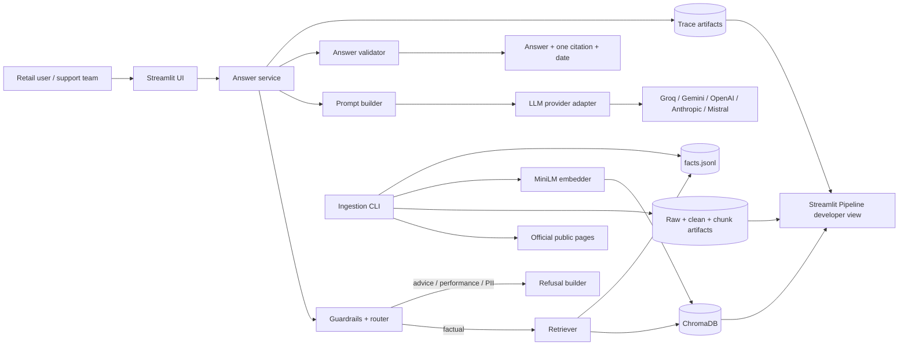
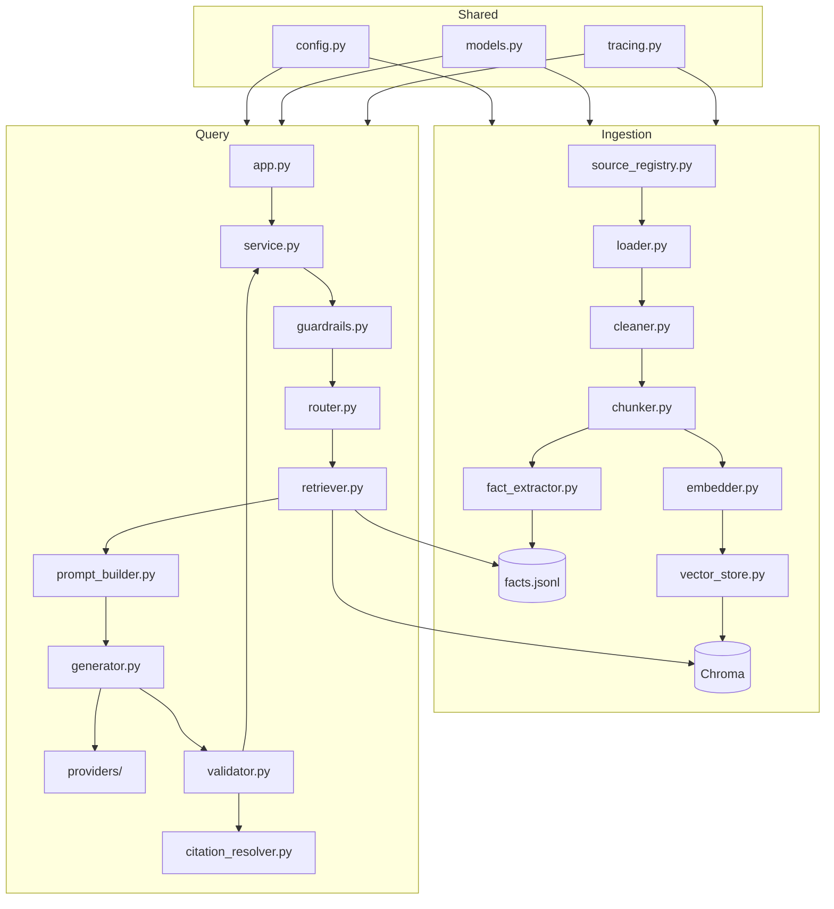
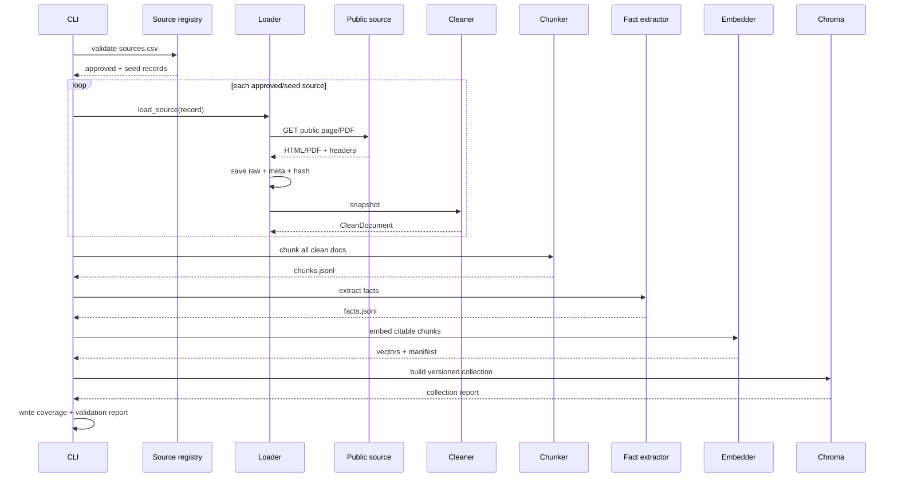
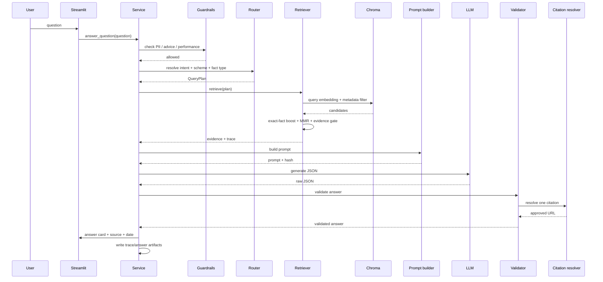
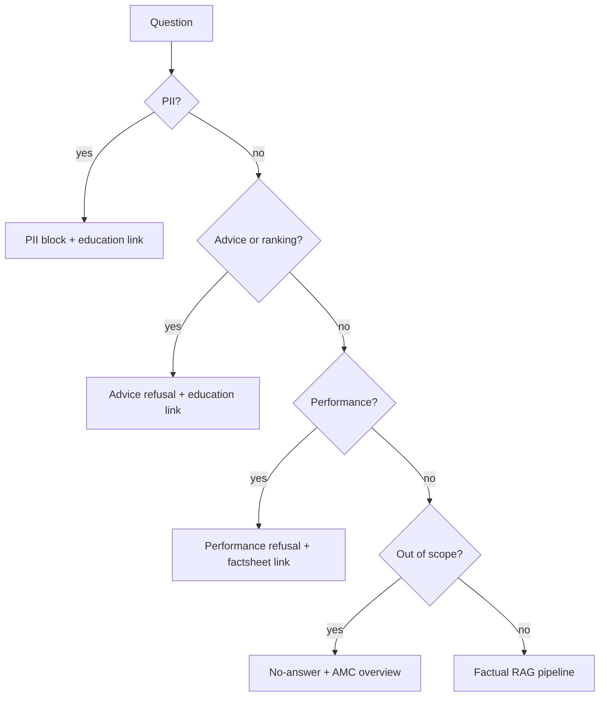

# Architecture — HDFC Mutual Fund Facts Assistant (RAG Demo)

| Field | Value |
|---|---|
| Version | 1.1 |
| Date | 2026-11-08 |
| Status | Phases 0–8 implemented; official corpus indexed; 25/25 gold-set checks pass; StitchWithGoogle UI export pending |
| Source requirements | [prd.md](prd.md) |
| Implementation plan | [implementation.md](implementation.md) |
| Architecture style | Local-first modular monolith: offline ingestion + online RAG query service |
| Primary runtime | Python 3.11+, Streamlit, sentence-transformers, ChromaDB |
| LLM | Provider-abstracted; local `.env` uses Gemini `gemini-3.5-flash-lite`; Groq remains the example default |

---

## 1. Purpose

This document translates [prd.md](prd.md) into an implementable technical architecture. It defines:

- System boundaries and components
- Data flow and stored artifacts for every RAG stage
- Module responsibilities and interfaces
- Data contracts and provenance rules
- Retrieval, generation, validation, and refusal flows
- Configuration, security, deployment, and testing approach
- Traceability from PRD requirements to architecture components

The architecture assumes the PRD’s recommended source policy:

- HDFC AMC, SEBI, AMFI, and official registrar pages are the only citable sources.
- The five supplied Groww URLs are ingested as **seed/cross-check** pages but are **not citable** in final answers.
- The current registry has **17 sources**: 12 official and 5 seed. Of the 12 official pages, 9 are citable answer sources and 3 are non-citable official cross-checks (TER reports, services index, statutory disclosures).
- If this policy changes, only the source allowlist, `citable` metadata, and validation rules change. The component design remains the same.

---

## 2. Architecture drivers

| Driver | Source | Architectural consequence |
|---|---|---|
| Facts-only, no advice | PRD C3, FR-11 | Guardrails run before retrieval; refusals never call the LLM |
| One source link per answer | PRD C2, FR-08 | Citation resolver is a hard gate; no citation means no answer |
| Official sources only | PRD Section 6 | Domain allowlist; seed pages marked non-citable |
| No performance claims | PRD C4, FR-12 | Performance sections stripped at ingestion; performance intent blocked at query time |
| No PII | PRD C5, FR-13 | PII detection before logging, retrieval, or generation |
| ≤3 sentences | PRD C6, FR-10 | Deterministic sentence validator after generation |
| Stage visibility | PRD C10, FR-16/17 | File-based artifacts + Streamlit Pipeline developer view |
| Config-driven | PRD C9, FR-18 | YAML + `.env` loaded into typed settings; no hard-coded models or store |
| Small corpus, low cost | PRD Section 15 | CPU embeddings, local Chroma, one LLM call per factual query |
| Graceful failure | PRD FR-20 | Extractive fallback without LLM |
| Reproducibility | PRD Section 15 | Content hashes, config hash, versioned collection, deterministic IDs |

---

## 3. System context



### 3.1 Trust boundaries

| Boundary | Inside | Outside |
|---|---|---|
| Public corpus | Approved HTML/PDF snapshots, extracted text, chunks, embeddings | Blogs, social media, private pages, screenshots |
| Application | Config, guardrails, retrieval, prompt, validation, artifacts | End-user browser, third-party LLM API |
| Sensitive data | None retained | User PII must never enter the system |

### 3.2 Runtime modes

1. **Full mode** — LLM key and model valid; retrieval + LLM generation.
2. **Extractive mode** — LLM unavailable; deterministic templates from the best evidence chunk.
3. **Ingestion-only mode** — build/rebuild corpus and Chroma without serving.
4. **Evaluation mode** — run gold set and write metrics.

---

## 4. Container view

| Container | Responsibility | Technology | Persistence |
|---|---|---|---|
| Streamlit UI | Chat, inline source links, sidebar topics/status, developer views | Streamlit | None; session state only |
| Query service | Orchestrates guardrails → retrieval → generation → validation | Python | Trace/answer JSON |
| Ingestion CLI | Load, clean, chunk, extract facts, embed, index, validate sources | Python CLI | `data/` artifacts |
| ChromaDB | Vector search over chunk embeddings with metadata filters | Chroma persistent client | `data/05_vector/chroma/` |
| Fact index | Exact scheme/fact lookup and retrieval boost | JSONL loaded into memory | `data/03_chunks/facts.jsonl` |
| Artifact store | Raw pages, clean docs, chunks, embeddings, traces, answers, eval | Local filesystem | `data/` |
| Provider adapter | Uniform LLM interface for five providers | `httpx` + provider-specific clients | None |
| Evaluation harness | Gold-set execution and metrics | Python + pytest | `data/08_eval/` |

No separate database, queue, or backend API is required for the demo. Files are the source of truth for inspection.

---

## 5. Component architecture



### 5.1 Module responsibilities

| Module | Responsibility | Key inputs | Key outputs |
|---|---|---|---|
| `src/config.py` | Load YAML + `.env`, validate settings, compute config hash | `config.yaml`, env | `Settings`, `config_hash` |
| `src/models.py` | Pydantic models for sources, documents, chunks, facts, traces, answers | Dicts/JSON | Typed objects |
| `src/source_registry.py` | Parse and validate `sources.csv`, enforce count/domain/citable rules | CSV | `list[SourceRecord]` |
| `src/loader.py` | Fetch HTML/PDF, cache raw bytes, write metadata sidecars | URLs | `SourceSnapshot` |
| `src/cleaner.py` | Extract main content, preserve headings/tables, remove performance/marketing sections | `SourceSnapshot` | `CleanDocument` |
| `src/chunker.py` | Page-type-aware chunking; deterministic IDs; token limits | `CleanDocument` | `list[Chunk]` |
| `src/fact_extractor.py` | Extract atomic fact cards for scheme/fact type | chunks, clean docs | `list[FactCard]` |
| `src/embedder.py` | Load MiniLM, normalize, batch embed, cache by chunk hash | chunks | vectors + manifest |
| `src/vector_store.py` | Create/version/upsert/query Chroma collection | chunks, vectors | collection report, search results |
| `src/guardrails.py` | PII, advice, performance, out-of-scope detection | raw question | `GuardrailResult` |
| `src/router.py` | Intent/entity/fact-type resolution and clarification | question | `QueryPlan` |
| `src/retriever.py` | Dense retrieval, filters, exact-fact boost, MMR, evidence gate | `QueryPlan` | `RetrievalTrace`, evidence |
| `src/prompt_builder.py` | Build grounded prompt from evidence + policy | evidence, question | prompt text + hash |
| `src/generator.py` | Call provider, parse JSON, retry once, fallback | prompt | `LLMResult` |
| `src/providers/` | Provider adapters: Groq, Gemini, OpenAI, Anthropic, Mistral | prompt, config | raw response |
| `src/validator.py` | Schema, citation, sentence, banned-term, numeric, scheme checks | `LLMResult`, evidence | `ValidatedAnswer` or failure |
| `src/citation_resolver.py` | Resolve chunk → source → approved URL; enforce allowlist | chunk IDs | `Citation` |
| `src/service.py` | End-to-end `answer_question()` orchestration | question | `AnswerResponse` |
| `src/tracing.py` | Trace IDs, timings, redacted events, artifact writes | events | trace JSON |
| `src/cli.py` | `validate-sources`, `ingest`, `index`, `eval`, `smoke` | commands | reports |
| `app.py` | Streamlit UI and Pipeline inspector | service, artifacts | UI |
| `src/ui/` | UI components and artifact readers | artifacts | Streamlit elements |

### 5.2 Core interfaces

```python
# src/source_registry.py
def load_registry(path: Path) -> list[SourceRecord]: ...

# src/loader.py
def load_source(source: SourceRecord, cfg: Settings) -> SourceSnapshot: ...

# src/cleaner.py
def clean_source(snapshot: SourceSnapshot, cfg: Settings) -> CleanDocument: ...

# src/chunker.py
def chunk_document(doc: CleanDocument, cfg: Settings) -> list[Chunk]: ...

# src/fact_extractor.py
def extract_facts(doc: CleanDocument, chunks: list[Chunk], cfg: Settings) -> list[FactCard]: ...

# src/embedder.py
def embed_chunks(chunks: list[Chunk], cfg: Settings) -> EmbeddingBatch: ...

# src/vector_store.py
def build_collection(chunks: list[Chunk], batch: EmbeddingBatch, cfg: Settings) -> CollectionReport: ...
def query_collection(vector: list[float], plan: QueryPlan, cfg: Settings) -> list[SearchHit]: ...

# src/service.py
def answer_question(question: str, cfg: Settings) -> AnswerResponse: ...
```

All interfaces accept typed models, not raw dictionaries, and raise domain-specific errors (`SourceBlockedError`, `ParseError`, `ConfigMismatchError`, `EvidenceGateError`).

---

## 6. Data architecture

### 6.1 Repository and artifact layout

```text
.
├── app.py
├── config.yaml
├── .env.example
├── requirements.txt
├── README.md
├── prd.md
├── architecture.md
├── DISCLAIMER.md
├── sources.md
├── sample_qa.md
├── eval_report.md
├── design/
│   └── README.md
├── src/
│   ├── config.py
│   ├── models.py
│   ├── source_registry.py
│   ├── loader.py
│   ├── cleaner.py
│   ├── chunker.py
│   ├── fact_extractor.py
│   ├── embedder.py
│   ├── vector_store.py
│   ├── guardrails.py
│   ├── router.py
│   ├── retriever.py
│   ├── prompt_builder.py
│   ├── generator.py
│   ├── validator.py
│   ├── citation_resolver.py
│   ├── service.py
│   ├── tracing.py
│   ├── cli.py
│   ├── providers/
│   │   ├── base.py
│   │   ├── groq.py
│   │   ├── gemini.py
│   │   ├── openai.py
│   │   ├── anthropic.py
│   │   └── mistral.py
│   └── ui/
│       ├── ask.py
│       ├── pipeline.py
│       ├── sources.py
│       └── evaluation.py
├── data/
│   ├── 00_sources/
│   │   ├── sources.csv
│   │   ├── source_checks.json
│   │   └── coverage_matrix.json
│   ├── 01_raw/
│   │   ├── {source_id}.html
│   │   ├── {source_id}.pdf
│   │   └── {source_id}.meta.json
│   ├── 02_clean/
│   │   └── {source_id}.json
│   ├── 03_chunks/
│   │   ├── chunks.jsonl
│   │   ├── facts.jsonl
│   │   └── chunk_report.json
│   ├── 04_embeddings/
│   │   ├── embeddings.npy
│   │   ├── chunk_id_map.json
│   │   └── manifest.json
│   ├── 05_vector/
│   │   ├── chroma/
│   │   └── collection_report.json
│   ├── 06_retrieval/
│   │   ├── {trace_id}.json
│   │   └── retrieval_eval.csv
│   ├── 07_answers/
│   │   ├── {trace_id}.json
│   │   ├── {trace_id}.prompt.txt
│   │   └── {trace_id}.llm_raw.json
│   └── 08_eval/
│       ├── gold_set.jsonl
│       ├── results.jsonl
│       └── metrics.json
└── tests/
    ├── test_guardrails.py
    ├── test_chunking.py
    ├── test_retrieval.py
    ├── test_validation.py
    └── test_end_to_end.py
```

### 6.2 Stage artifact contract

| Stage | Artifact | What the demo must show |
|---|---|---|
| Source registry | `sources.csv`, `source_checks.json` | URL, publisher, type, status, citable flag |
| Loading | `01_raw/*`, `*.meta.json` | HTTP status, fetched time, hash, parser |
| Cleaning | `02_clean/*.json` | Sections retained, removed sections, text length |
| Chunking | `03_chunks/chunks.jsonl`, `chunk_report.json` | Text, scheme, fact type, token count, source |
| Facts | `03_chunks/facts.jsonl` | Atomic values, as-of date, verification state |
| Embedding | `04_embeddings/manifest.json` | Model, revision, dimension, normalization, count |
| Vector DB | `05_vector/collection_report.json` | Collection, count, distance, metadata sample |
| Retrieval | `06_retrieval/{trace_id}.json`, `retrieval_eval.csv` | Candidates, scores, filters, selected chunks, gate result |
| Generation | `07_answers/{trace_id}.prompt.txt`, `.llm_raw.json` | Prompt and raw model output |
| Answer | `07_answers/{trace_id}.json` | Final answer, citation, date, validation |
| Evaluation | `08_eval/metrics.json` | Accuracy, citations, refusals, PII, latency |

### 6.3 Source record

```json
{
  "source_id": "amc_hdfc_large_cap_direct",
  "url": "https://www.hdfcfund.com/...",
  "final_url": "https://www.hdfcfund.com/...",
  "title": "HDFC Large Cap Fund — Direct Growth",
  "publisher": "HDFC AMC",
  "source_type": "amc",
  "purpose": "scheme_facts",
  "scheme_slugs": ["hdfc-large-cap-fund-direct-growth"],
  "http_status": 200,
  "fetched_at": "2026-11-01T09:00:00Z",
  "last_modified": null,
  "content_hash": "sha256:...",
  "parser": "html",
  "status": "approved",
  "citable": true,
  "notes": ""
}
```

Rules:

- `status=approved` and `citable=true` are required for indexing.
- `source_type=seed` implies `citable=false`.
- `http_status` must be 200 and the final URL must remain on an allowlisted domain.
- Empty `last_modified` means the UI uses `fetched_at` and appends “(retrieved)”.

### 6.4 Clean document

```json
{
  "source_id": "amc_hdfc_large_cap_direct",
  "url": "https://www.hdfcfund.com/...",
  "title": "HDFC Large Cap Fund — Direct Growth",
  "source_type": "amc",
  "scheme_slugs": ["hdfc-large-cap-fund-direct-growth"],
  "sections": [
    {
      "section_id": "expense-ratio",
      "heading": "Expense ratio",
      "level": 2,
      "order": 7,
      "text": "Expense ratio ...",
      "tables": [],
      "page": null
    }
  ],
  "removed_sections": ["returns", "rankings", "portfolio_holdings", "fund_manager_bio"],
  "clean_text_hash": "sha256:..."
}
```

### 6.5 Chunk

```json
{
  "chunk_id": "ch_sha256_...",
  "source_id": "amc_hdfc_large_cap_direct",
  "source_url": "https://www.hdfcfund.com/...",
  "source_type": "amc",
  "citable": true,
  "scheme": "HDFC Large Cap Fund Direct Growth",
  "scheme_slug": "hdfc-large-cap-fund-direct-growth",
  "fact_type": "expense_ratio",
  "section": "Expense ratio",
  "page": null,
  "text": "Scheme: HDFC Large Cap Fund Direct Growth | Fact: expense ratio | Expense ratio: 1.02%",
  "token_count": 31,
  "char_count": 108,
  "content_hash": "sha256:...",
  "chunker_version": "1.0",
  "retrieved_at": "2026-11-01T09:00:00Z"
}
```

### 6.6 Fact card

```json
{
  "fact_id": "hdfc-large-cap__expense_ratio",
  "chunk_id": "ch_sha256_...",
  "scheme": "HDFC Large Cap Fund Direct Growth",
  "scheme_slug": "hdfc-large-cap-fund-direct-growth",
  "fact_type": "expense_ratio",
  "value_text": "1.02%",
  "value_normalized": 1.02,
  "unit": "percent",
  "as_of": "2026-10-30",
  "source_id": "amc_hdfc_large_cap_direct",
  "source_url": "https://www.hdfcfund.com/...",
  "source_type": "amc",
  "verified": true,
  "conflict": false,
  "retrieved_at": "2026-11-01T09:00:00Z"
}
```

### 6.7 Retrieval trace

```json
{
  "trace_id": "tr_20261101_...",
  "question_redacted": "expense ratio of HDFC Large Cap Fund Direct Growth",
  "intent": "factual",
  "scheme_slug": "hdfc-large-cap-fund-direct-growth",
  "fact_type": "expense_ratio",
  "filters": {"scheme_slug": "hdfc-large-cap-fund-direct-growth", "fact_type": "expense_ratio", "citable": true},
  "candidates": [
    {"chunk_id": "ch_...", "score": 0.81, "rank": 1, "source_url": "https://..."}
  ],
  "selected": ["ch_..."],
  "evidence_gate": {"passed": true, "reason": "top_score_above_threshold"},
  "timings_ms": {"guardrails": 4, "embedding": 18, "retrieval": 22, "generation": 1800, "validation": 3},
  "config_hash": "...",
  "model": "provider/model"
}
```

### 6.8 Answer record

```json
{
  "trace_id": "tr_20261101_...",
  "answer_type": "fact",
  "answer": "The expense ratio of HDFC Large Cap Fund Direct Growth is 1.02%.",
  "citation": {
    "title": "HDFC Large Cap Fund — Direct Growth",
    "url": "https://www.hdfcfund.com/...",
    "source_type": "amc",
    "chunk_id": "ch_..."
  },
  "last_updated_from_sources": "2026-11-01",
  "fallback_used": false,
  "validation": {"passed": true, "checks": ["schema", "citation", "sentences", "banned_terms", "numbers", "scheme"]}
}
```

### 6.9 Provenance chain

```text
Answer
  → citation.chunk_id
    → chunk.source_id
      → source registry URL
        → raw snapshot hash
          → fetched_at
```

Every rendered citation must be reconstructable through this chain. A chunk without a valid source record cannot be cited.

---

## 7. Ingestion architecture

### 7.1 Ingestion sequence



### 7.2 Loader

Responsibilities:

- Fetch with `httpx` or `requests`, 20 s timeout, 2 retries with backoff.
- Rate limit: at least 1 s between requests to the same host.
- Respect `robots.txt` where available.
- Use a descriptive user agent.
- Follow redirects but validate the final host against the allowlist.
- Save raw bytes and a `.meta.json` sidecar.
- For PDFs, store the file and page count; flag image-only PDFs for OCR/manual review.
- Never use login, cookies, paywall, or private endpoints.

Status handling:

| Condition | Status | Indexed? |
|---|---|---|
| 200 + parseable | `approved` | Yes, if citable |
| 200 + `seed_only` | `seed_only` | No; retained for cross-check |
| 403/429 | `blocked` | No |
| Parse failure | `parse_failed` | No |
| Manual public snapshot | `manual_review` until approved | Only after approval |
| Non-allowlisted redirect | `blocked` | No |

### 7.3 Cleaner

Steps:

1. Parse HTML with BeautifulSoup/lxml or PDF with pypdf.
2. Remove navigation, footer, ads, scripts, cookie banners, related links, and app-download prompts.
3. Keep headings, paragraphs, ordered lists, and tables.
4. Apply a **section allowlist** for the seven fact types, AMC overview, and statement help.
5. Apply a **section denylist** for returns, CAGR, rankings, NAV history, portfolio holdings, fund-manager bios, and marketing claims.
6. Preserve table headers with rows.
7. Normalize whitespace and currency symbols; keep original text for citation.
8. Record removed sections in `removed_sections`.
9. Compute `clean_text_hash`.

The cleaner must be conservative: if a section is ambiguous, keep it for review but do not mark it as a verified fact.

### 7.4 Chunker

Chunking is page-type aware and deterministic.

| Page type | Strategy | Token target |
|---|---|---|
| Scheme page | One atomic fact card per scheme/fact type + small narrative chunks | 20–80 for facts; 180–220 narrative |
| SID/SAI/KIM | Section-aware chunks, preserve clause numbers and table rows | 180–220 |
| AMC overview | Section chunks | 180–220 |
| Statement help | Ordered steps; keep steps together | 100–200 |
| Regulatory/education | One concept per paragraph chunk | 150–220 |

Rules:

- Hard maximum 240 tokens, counted with the MiniLM tokenizer **after** adding the retrieval prefix.
- Overlap 30 tokens for narrative chunks; no overlap for fact cards.
- Prefix: `Scheme: {scheme} | Fact: {fact_type} |`.
- Never merge two schemes into one chunk.
- Never split a table row from its header.
- Do not chunk empty, boilerplate, or denylisted sections.
- Chunk ID = `"ch_" + sha256(source_id + section_id + chunk_index + text)[:24]`.
- Fact ID = `"{scheme_slug}__{fact_type}"`.
- Record `chunker_version`; changing chunk logic invalidates the collection.

### 7.5 Fact extraction

Fact types and extraction approach:

| Fact type | Extraction approach | Normalization |
|---|---|---|
| `expense_ratio` | Regex/label match near “Expense ratio”; direct-plan value only | Float + `%` |
| `exit_load` | Label/table match; capture percentage and period | Text + optional float/period |
| `min_sip` | Label match near “Minimum SIP” | Currency amount |
| `lock_in` | ELSS-specific label/clause; “3 years” | Text + months |
| `riskometer` | Label match; risk level + date | Text |
| `benchmark` | Label match near “Benchmark” | Index name |
| `statement_process` | Ordered list extraction from statement-help page | Ordered steps |
| `amc_overview` | Section extraction | Text fields |

Verification rules:

- `verified=true` only when the value appears in an approved official source and no conflicting official value exists.
- `conflict=true` if two official sources disagree. The fact is not answerable until resolved.
- Seed/cross-check values are stored in a separate `crosscheck` field and never used as the final citation.
- If a required fact is missing, write `verified=false`; the retriever must return no-answer for it.

### 7.6 Embedding and indexing

- Model: `sentence-transformers/all-MiniLM-L6-v2`, revision pinned in config.
- Dimension: 384; max sequence length 256; normalized vectors; float32.
- Batch size 32; CPU by default.
- Embedding cache key: `sha256(chunk_text + model_name + model_revision)`.
- Chroma collection: `mf_facts_v1_<manifest_hash[:12]>`.
- Distance: cosine.
- Metadata fields: `source_id`, `source_url`, `source_type`, `citable`, `scheme`, `scheme_slug`, `fact_type`, `section`, `page_type`, `retrieved_at`, `chunk_id`.
- Upsert with `chunk_id` for idempotency.
- Rebuild when chunker version, model revision, or corpus hash changes.
- The app must refuse to query a collection whose manifest hash does not match the current embedding manifest.
- The main collection contains only `citable=true` chunks. Seed-only corpora also get a separate `<main>_seed` inspection collection; it is never queried for answers or citations.

### 7.7 Ingestion reports

`chunk_report.json` includes:

- Source count, approved count, seed count, blocked count
- Chunk count by page type and fact type
- Token distribution: min, median, p95, max
- Rejected sections count
- Facts verified/unverified/conflict counts
- Coverage matrix: scheme × fact type

`collection_report.json` includes:

- Main collection name, citable count, distance metric
- Seed inspection collection name/count, if present
- Embedding model/revision and manifest hash
- Config hash, chunker version, corpus hash
- Smoke-query results per scheme and a seed-only warning when no citable evidence exists

---

## 8. Query architecture

### 8.1 Factual query sequence



### 8.2 Query pipeline order

The order is fixed:

1. Length check (≤500 characters).
2. PII detection.
3. Advice/performance detection.
4. Intent classification.
5. Entity and fact-type resolution.
6. Clarification if required.
7. Retrieval.
8. Evidence gate.
9. Prompt construction.
10. LLM call.
11. Validation.
12. Citation resolution.
13. Response + trace write.

Guardrail failures never call retrieval or the LLM.

### 8.3 Guardrails

#### PII detection

Patterns:

- PAN: `[A-Z]{5}[0-9]{4}[A-Z]`
- Aadhaar: 12 digits with optional spaces/hyphens
- Indian phone: 10 digits or `+91` variant
- Email
- OTP-like 4–8 digit standalone code
- Account/folio/client ID near keywords
- Credential-like strings

Behavior:

- Set `pii_blocked=true`, `pii_types=[...]`.
- Do not log raw question.
- Store SHA-256 hash + redacted question.
- Return a refusal with an educational citation.
- Never echo the detected value.

#### Advice detection

Block if the question asks for:

- buy/sell/hold/invest/stop/switch
- recommendation, best, better, compare, ranking
- portfolio, allocation, suitability, risk profile
- “should I”, “is it safe”, “will it grow”

Allowed factual rewrites are offered, e.g. “You can ask for the expense ratio, exit load, or riskometer instead.”

#### Performance detection

Block if the question asks for:

- returns, CAGR, absolute return, annualized return
- profit, loss, “will it double”, “how much will I make”
- comparison of returns or rankings
- NAV history

Response: refuse calculation/comparison; link to the official factsheet page from the source registry. Do not include performance values.

#### Out-of-scope detection

- Other AMC or scheme not in the four covered schemes
- Real-time NAV
- Tax filing or personal tax advice
- Account-specific actions

Response: no-answer + HDFC AMC overview link.

#### Prompt injection

- Treat question text as data.
- Treat retrieved context as untrusted data.
- Ignore instructions inside context.
- Do not expose system prompt.
- No tool use or code execution.
- Log injection patterns as safety events without PII.

### 8.4 Intent and entity router

`QueryPlan`:

```json
{
  "intent": "factual",
  "scheme": "HDFC ELSS Tax Saver Fund Direct Plan Growth",
  "scheme_slug": "hdfc-elss-tax-saver-fund-direct-plan-growth",
  "fact_type": "lock_in",
  "needs_clarification": false,
  "confidence": 0.94
}
```

Scheme aliases:

| Alias | Canonical scheme |
|---|---|
| large cap, large-cap, hdfc large cap | HDFC Large Cap Fund Direct Growth |
| flexi, flexi cap, equity fund | HDFC Flexi Cap Direct Plan Growth |
| elss, tax saver, tax saving | HDFC ELSS Tax Saver Fund Direct Plan Growth |
| mid cap, midcap | HDFC Mid Cap Fund Direct Growth |
| amc, fund house, hdfc mutual fund | HDFC Mutual Fund (AMC overview) |

Fact-type aliases:

| Alias | Fact type |
|---|---|
| expense ratio, TER, total expense | `expense_ratio` |
| exit load, redemption fee | `exit_load` |
| minimum sip, min sip, sip amount | `min_sip` |
| lock in, lock-in, lockin | `lock_in` |
| riskometer, risk level, risk | `riskometer` |
| benchmark, index | `benchmark` |
| statement, capital gain statement, CAS, download statement | `statement_process` |
| registrar, fund house, AMC | `amc_overview` |

Rules:

- If no scheme is detected for a scheme-specific fact, ask for clarification.
- If multiple schemes are detected, ask the user to choose one.
- If multiple fact types are detected, answer the primary/first fact and offer the other as a follow-up question.
- Never infer a scheme from a previous session; no cross-session memory.

### 8.5 Retrieval

Algorithm:

```text
1. Normalize question.
2. Embed with the same model/revision/normalization as ingestion.
3. Build Chroma filter:
   - citable = true
   - scheme_slug = plan.scheme_slug (when present)
   - fact_type = plan.fact_type (when confidently detected)
4. Query top_k = 12.
5. Filter attempts, stopping at the first attempt with at least 3 unique candidates:
   - `scheme + fact`
   - `scheme` only
   - `fact` only
   - `citable` only
6. Apply exact-fact boost:
   - Look up facts.jsonl by scheme + fact type.
   - Prefer a verified official fact over a seed cross-check.
   - If the canonical fact chunk is in candidates, add a small boost (configurable, default +0.05).
7. Apply MMR (lambda = 0.70) and select final_k = 4.
8. Evidence gate:
   - top passing candidate score >= 0.30 (a high-scoring candidate that fails a scheme/fact/citability check cannot satisfy the gate)
   - source_type in allowed citable types
   - citable = true
   - scheme matches
   - fact_type or section/text matches the requested fact
   - for verified numeric facts, the candidate text contains the value or a normalized equivalent
   - no performance/returns/ranking language
9. If the gate fails, return no-answer; do not call the LLM.

If the main collection is missing, stale, or empty, retrieval fails closed before embedding. The non-citable inspection collection is never queried.

Retrieval output is a `RetrievalTrace` with every candidate, score, filter attempt, selected chunk IDs, gate result, and timings. `data/06_retrieval/retrieval_eval.csv` records one summary row per trace. The UI shows these in “Inspect this answer”.

### 8.6 Prompt construction

The prompt contains:

1. System rules from PRD Section 11.8.
2. User question.
3. Up to four evidence blocks:

```text
<context>
  <chunk id="ch_..." source_type="amc" scheme="..." fact_type="expense_ratio">
  Scheme: ... | Fact: expense ratio | Expense ratio: 1.02%
  </chunk>
</context>
```

4. JSON output instruction.
5. No URLs, titles, or facts outside context.
6. Context is marked as untrusted data.

The prompt builder computes `prompt_hash` for the trace.

### 8.7 LLM provider abstraction

```python
class LLMProvider(Protocol):
    name: str

    def validate_model(self, model: str) -> None: ...
    def generate(self, prompt: str, *, model: str, temperature: float, max_tokens: int) -> str: ...
```

Provider matrix:

| Provider | Config value | API style | Default base URL |
|---|---|---|---|
| Groq | `groq` | OpenAI-compatible chat completions | `https://api.groq.com/openai/v1` |
| OpenAI | `openai` | OpenAI chat completions | `https://api.openai.com/v1` |
| Mistral | `mistral` | OpenAI-compatible chat completions | `https://api.mistral.ai/v1` |
| Gemini | `gemini` | Google Generative Language API | Provider default |
| Anthropic | `anthropic` | Messages API | `https://api.anthropic.com` |

Rules:

- Provider and model come from `LLM_PROVIDER` / `LLM_MODEL` in `.env`.
- API key comes from the env var named in config (`GROQ_API_KEY`, etc.).
- Never hard-code a model ID.
- Validate the model at startup when the provider exposes a models endpoint; otherwise perform a minimal low-cost validation call.
- Timeout 30 s; one retry on transient 429/5xx; one repair retry for invalid JSON.
- Temperature 0.1; max tokens 220.
- No tool calls, no browsing, no streaming.
- If key is missing/invalid, switch to extractive mode and show a visible banner.
- The exact model proposed in the brief (`qwen/qwen3.8-27b`) is not assumed to exist.

### 8.8 Answer validation

Checks, in order:

1. JSON schema valid.
2. `answer_type` is `fact` or `no_answer`.
3. `answer` is non-empty and ≤3 sentences.
4. `citation_chunk_id` exists in selected evidence.
5. Citation URL resolves to an approved `citable=true` source.
6. Citation scheme matches the requested scheme.
7. No banned advice/performance terms.
8. No numeric value absent from the cited chunk.
9. No URL in the answer body other than the rendered citation.
10. No scheme mismatch or plan confusion.

Failure handling:

- Invalid JSON → one repair prompt → then extractive fallback.
- Invalid citation → choose the top supporting chunk if safe; otherwise no-answer.
- Sentence limit violation → deterministic truncation is **not** allowed if it removes meaning; use extractive fallback.
- Numeric mismatch → no-answer + trace.
- Banned terms → refusal or extractive fallback.

### 8.9 Extractive fallback

When the LLM is unavailable or validation fails, generate from the canonical fact card:

| Fact type | Template |
|---|---|
| `expense_ratio` | “The expense ratio of {scheme} is {value}.” |
| `exit_load` | “The exit load for {scheme} is {value}.” |
| `min_sip` | “The minimum SIP for {scheme} is {value}.” |
| `lock_in` | “{scheme} has a lock-in of {value}.” |
| `riskometer` | “The riskometer level for {scheme} is {value}.” |
| `benchmark` | “The benchmark for {scheme} is {value}.” |
| `statement_process` | First 2–3 ordered steps from the official page. |
| `amc_overview` | The relevant AMC fact from the selected chunk. |

The fallback still passes the citation resolver and sentence validator. The UI shows a small “Extractive fallback was used” note under the card, the sidebar status explains the provider state, and the trace records `fallback_used=true`.

### 8.10 Refusal flow



Refusal source selection:

- Advice/ranking/PII → `sebi_investor_education` or `amfi_investor_education` from the source registry.
- Performance → `amc_factsheet_index` from the source registry.
- Out-of-scope → `amc_overview` from the source registry.
- All refusal citations must be approved and citable.

### 8.11 Citation resolver

Steps:

1. Receive `chunk_id` from validation.
2. Load chunk metadata.
3. Load source record by `source_id`.
4. Reject if `citable=false`, `status!=approved`, or `source_type=seed`.
5. Parse URL; require `https`.
6. Require hostname on the allowlist.
7. Require scheme metadata to match the requested scheme.
8. Return `Citation(title, url, source_type, chunk_id)`.

If resolution fails, no answer is rendered; the service returns a no-answer with the AMC overview link.

---

## 9. UI architecture

### 9.1 Pages

| View | Contents |
|---|---|
| Chat (default) | FundFacts welcome, topic sidebar, facts-only banner, chat messages with one inline source, fixed composer |
| Pipeline | Developer view: stage status, source counts, chunk samples, embedding manifest, Chroma report, latest retrieval trace |
| Sources | Developer view: registry table, status, citable flag, fetched date, purpose |
| Evaluation | Developer view: gold-set results, metrics, failure table |

### 9.2 Ask page components

```text
Sidebar: FundFacts shield logo (assets/logo.svg) + "FundFacts" / "Mutual fund assistant"
         [✨ New chat]
         4 HDFC funds | 17 Public sources
         EXPLORE A TOPIC: nine topic pills
         WHY TRUST IT: four checks
         System status / Developer view (collapsed)

Main:    Hero: "Mutual Fund Facts Assistant"
                "Ask anything factual about selected HDFC Mutual Fund schemes."
                [🔍 lock-in] [％ exit load] [🛡️ Should I invest...?]
         Banner: gradient card with "Facts-only. No investment advice." + explanation
         User: mint bubble, right-aligned, max 85%
         Assistant: white card, label, answer, inline source URL, last-updated date
         Loading: three pulsing green dots in an assistant card
Composer: fixed st.form, 500-character input, round green ↑, disabled when empty
```

The composer enforces the 500-character cap. PII is redacted by the guardrail before a pending question is rendered, and the stored turn uses `question_redacted`. Every factual answer keeps one official inline source link and the `Last updated from sources` date. The main column is capped at 768 px. The three welcome suggestions and the sidebar topics ask their question directly instead of filling the input.

### 9.3 Session state

- Store every chat turn in session state only; each turn keeps a redacted question, answer, and trace ID.
- New chat clears the transcript and returns to the welcome state.
- No RECENT list, dark-mode state, or active-turn selection is stored.
- No chat history persisted to disk.
- No user identity, cookies, or login.
- No PII fields or uploads.
- Corpus/index and LLM availability messages live in the sidebar status expander, never in the chat column.

### 9.4 Pipeline inspector

- Read artifacts from `data/`.
- Show counts and samples, not full raw HTML.
- Show raw page metadata and hash, not private content.
- Show chunk text, token count, source, and fact type.
- Show Chroma collection stats and a sample similarity query.
- Show latest trace: filters, candidate scores, selected chunks, prompt hash, raw LLM output, validation checks.
- Never show API keys or `.env` values.

### 9.5 UI failure states

| State | UI |
|---|---|
| LLM missing/invalid | Sidebar System status shows extractive mode; chat still answers |
| Chroma missing | Sidebar System status shows indexing guidance; main chat stays free of setup messages |
| Low retrieval | Assistant card labelled `Not in sources`; AMC overview link when available |
| Citation validation failure | `Not in sources` card; trace records failure |
| Pipeline exception | `Temporarily unavailable` card; diagnostics stay in the sidebar |
| PII blocked | Facts-only refusal card; the redacted question is shown, never the raw value |
| Long question | Composer enforces the 500-character cap; no live counter is shown |

### 9.6 Lovable prototype design source of truth

The UI follows the linked Lovable prototype at `https://newai-iota-indol.vercel.app/`:

- 300 px lavender sidebar with the FundFacts shield logo, `FundFacts` wordmark, `Mutual fund assistant` subtitle, `✨ New chat`, two stat cards, nine `EXPLORE A TOPIC` pills, and a `WHY TRUST IT` checklist.
- Centered welcome hero `Mutual Fund Facts Assistant`, subtitle, three full-width suggestion buttons, and a gradient facts-only banner.
- Chat messages use `st.chat_message` with avatars hidden: mint user bubbles on the right and white assistant cards with a status label, answer text, inline `🔗` source URL, and `Last updated from sources: YYYY-MM-DD`.
- Fixed rounded composer with a borderless 500-character input and a round green `↑` send button; the button is disabled while the input is empty.
- Tokens: surface `#FAF8FF`, low `#F2F3FF`, mid `#EAEDFF`, ink `#131B2E`, muted `#3C4A43`, primary `#006C4F`, accent `#00B386`, link `#005AC2`, error `#BA1A1A`; Inter body text and Plus Jakarta Sans headings.

The linked prototype does not include a dark-mode toggle, RECENT history, a bordered source-card expander, or copy/feedback controls. Those were removed so the Streamlit UI matches the reference. Pipeline, Sources, and Evaluation remain available from the collapsed System status expander. The custom CSS lives in one injected `st.markdown` block in `src/ui/common.py`; the Streamlit theme in `.streamlit/config.toml` matches the same palette. The prototype does not override the product safety rules: no PII inputs, no uploads, no login, no persistent chat history, no system prompt, and no secrets.

The older Stitch export is not required for this restyle and was not present in the workspace. AppTest and a local `streamlit run app.py` health check are the available verification steps in this environment.

---

## 10. Configuration architecture

### 10.1 Layers

1. `config.yaml` — non-secret defaults and pipeline settings.
2. `.env` — secrets and provider/model selection.
3. CLI flags — one-off overrides for ingestion/eval only.
4. No UI-editable secrets.

### 10.2 Config hash and versioning

`config_hash = sha256(canonical_json(embedding + chunking + vector_db + retrieval + model_revision))`

Used for:

- Collection name: `mf_facts_v1_<hash[:12]>`
- Manifest validation
- Startup mismatch detection

If `config_hash` changes:

- Rebuild embeddings and collection.
- Do not mix old and new vectors.
- The UI shows “Index is stale — rebuild required” until rebuilt.

### 10.3 Startup checks

| Check | Failure behavior |
|---|---|
| `config.yaml` present and valid | Fatal setup error |
| `sources.csv` exists and 15–25 rows | Fatal for ingestion; UI can still start read-only |
| Chroma directory exists | UI banner + setup command |
| Embedding model cached/downloadable | Fatal for ingestion; UI read-only |
| Manifest matches config | UI banner “rebuild required” |
| `LLM_MODEL` set | Extractive mode if empty |
| Provider key present | Extractive mode if missing |
| Model valid | Extractive mode + banner; log config error |
| Citation allowlist configured | Fatal setup error |

### 10.4 Environment variables

```dotenv
LLM_PROVIDER=groq
LLM_MODEL=
GROQ_API_KEY=
GEMINI_API_KEY=
OPENAI_API_KEY=
ANTHROPIC_API_KEY=
MISTRAL_API_KEY=
```

No keys in YAML, logs, traces, UI, or git. `.env.example` is committed; `.env` is ignored.

---

## 11. Security, privacy, and compliance architecture

### 11.1 PII

- Detect before logging, retrieval, and generation.
- Do not echo, store, or send raw PII to the LLM.
- Store only hash + redacted question + `pii_types`.
- Never ask for PAN, Aadhaar, account, OTP, email, or phone.
- Never retrieve or display a user’s actual statement.
- Official contact details in public source pages are corpus data, not user PII.

### 11.2 Advice and performance

- Guardrails run before retrieval.
- Performance sections are removed at ingestion, so the LLM cannot retrieve returns even if asked indirectly.
- Factsheet links are allowed only for performance refusals; no performance numbers are generated.
- Refusals are polite, brief, and offer a factual alternative.

### 11.3 Prompt injection

- Context is wrapped in `<context>` and labelled untrusted.
- System prompt explicitly says to ignore instructions in context.
- No tools, browsing, code execution, or file access from the model.
- Strip scripts/HTML from context.
- Log injection attempts as safety events without PII.

### 11.4 Link safety

- `https` only.
- Hostname allowlist: HDFC AMC, SEBI, AMFI, CAMS, KFintech.
- No `javascript:`, `data:`, redirectors, or URL shorteners.
- Citation title comes from the source registry, not the LLM.
- URL is rendered as a link; raw URL may be shown in the trace only.

### 11.5 Secrets

- `.env` only; never sent to the browser.
- Hosted demo must keep keys server-side.
- Rotate keys after recording/demo if exposed.
- Do not log headers or full provider responses containing secrets.

### 11.6 Data retention

- No raw PII.
- Trace/answer artifacts may be kept for demo evaluation; they contain redacted questions only.
- Provide a cleanup command to delete `data/06_retrieval` and `data/07_answers` without deleting the corpus.

---

## 12. Observability and evaluation

### 12.1 Trace fields

Every answer writes:

- `trace_id`, timestamp
- `question_redacted`, `question_hash`
- `intent`, `scheme_slug`, `fact_type`
- `filters`, `candidates`, `scores`, `selected`
- `evidence_gate` result
- `prompt_hash`
- provider/model
- `fallback_used`
- validation checks
- timings
- `config_hash`
- citation URL and source ID

No raw PII, API keys, or full provider headers.

### 12.2 Metrics

| Metric | Source |
|---|---|
| Retrieval hit@3 | Gold set + trace |
| Citation validity | Validator |
| Citation support | Manual review + gold set |
| Answer accuracy | Gold set |
| Refusal precision | Gold set |
| PII block rate | Guardrail tests |
| Length compliance | Validator |
| p95 latency | Trace timings |
| Fallback rate | Trace |

### 12.3 Evaluation harness

`python -m src.cli eval`:

1. Load `data/08_eval/gold_set.jsonl`.
2. Run `answer_question()` for each item.
3. Compare answer type, fact, citation, refusal, PII behavior.
4. Write `results.jsonl` and `metrics.json`.
5. Print failures with trace IDs.

Gold set composition: 10 scheme facts, 3 statement/AMC, 4 advice refusals, 3 performance refusals, 3 PII blocks, 2 out-of-scope.

Current result (2026-11-08, Gemini `gemini-3.5-flash-lite`): 25/25 passed, 1.0 fact pass rate, 1.0 refusal pass rate, 1.0 citation rate, 1.0 PII-block rate, 0.0 synthetic PII present in artifacts, and 0 fallback answers. Artifacts are in `data/08_eval/`; the root [eval_report.md](eval_report.md) mirrors the generated report.

### 12.4 Testing

Unit:

- PII regex and redaction
- Advice/performance classifier
- Chunk token limits and deterministic IDs
- Fact extraction/normalization
- Citation allowlist
- Sentence counter and banned terms
- Numeric validator

Integration:

- Ingestion on fixture HTML/PDF
- Chroma build/query/filter
- End-to-end answer with a fake provider
- Extractive fallback
- Config mismatch refusal

End-to-end:

- 25-question gold set — current run 25/25
- Streamlit AppTest smoke check — passed (Ask, Pipeline, Sources, Evaluation, question input, clear-session control, no exceptions)
- 380 px visual check — CSS breakpoints and responsive padding are present; browser screenshot remains unavailable

---

## 13. Deployment architecture

### 13.1 Local demo (default)

```bash
python3.11 -m venv .venv
source .venv/bin/activate
pip install -r requirements.txt
cp .env.example .env
# set LLM_MODEL and one provider key, or leave blank for extractive mode
python -m src.cli validate-sources
python -m src.cli ingest --stage all
python -m src.cli smoke
python -m src.cli eval
streamlit run app.py
```

Outputs:

- App at `http://localhost:8501`
- Artifacts under `data/`
- Demo video if hosting is not possible

### 13.2 Optional Docker

- Base image: `python:3.11-slim`
- Mount `data/` and `chroma/` as volumes
- Pass env vars at runtime
- Do not bake `.env` into the image
- One process for Streamlit; ingestion via `docker run … python -m src.cli ingest --stage all`

### 13.3 Hosted demo

- Render web service or Streamlit Community Cloud.
- Store provider key in server-side secrets, never client-side.
- Prebuild the Chroma collection and commit only non-secret artifacts, or run ingestion at deploy time. This repository commits the cleaned sources, chunks, embeddings, Chroma collection, and evaluation artifacts; raw HTML and query logs stay local-only.
- Render settings: root directory blank, build `pip install --upgrade pip && pip install -r requirements.txt`, start `streamlit run app.py --server.address 0.0.0.0 --server.port $PORT --server.headless true`, health check `/_stcore/health`.
- Use the checked-in `render.yaml` and `.python-version` (`3.12.8`).
- Disable file uploads and PII fields.
- Rate-limit if public.
- Prefer a short-lived demo key.

### 13.4 Demo fallback

If hosting is unavailable:

- Record a ≤3-minute video showing:
  1. Welcome + disclaimer
  2. Expense ratio answer + source
  3. ELSS lock-in answer + source
  4. Advice refusal
  5. PII block
  6. Pipeline developer view stages

---

## 14. Failure modes and degradation

| Failure | Behavior | User sees |
|---|---|---|
| Source 403/429 | Mark blocked, skip indexing | No answer for that fact; source status in Pipeline |
| PDF parse failure | Mark `parse_failed`, do not index | No answer; manual review flag |
| Embedding model unavailable | Ingestion fails; UI read-only | Setup guidance in sidebar status |
| Chroma missing/stale | No retrieval | Indexing guidance in sidebar status; main chat stays clean |
| LLM key missing | Extractive mode | Sidebar status; extractive answer |
| LLM model invalid | Extractive mode + config error log | Same sidebar status |
| LLM timeout/5xx | One retry, then extractive | Answer may be extractive |
| Invalid JSON | One repair, then extractive | Answer may be extractive |
| Citation invalid | No-answer | No-answer card |
| Low similarity | No-answer | No-answer card + overview link |
| Conflicting official facts | No-answer + conflict flag | “Couldn’t verify” |
| PII detected | Block before logging | PII refusal |
| Prompt injection | Ignore context instructions; refuse if advice | Safe refusal/no-answer |
| Stale source | Date line shows source/retrieval date | Transparency |

The system must fail closed for facts: no evidence, no answer. It may fail open only for availability of the LLM, via extractive mode.

---

## 15. Build sequence

| Phase | Architecture work | Exit artifact |
|---|---|---|
| 0 | Config loader, models, source registry, allowlist, env checks | `config.yaml`, `sources.csv`, startup report |
| 1 | Loader, cleaner, raw/clean artifacts | `01_raw/`, `02_clean/` |
| 2 | Chunker, fact extractor, coverage report | `03_chunks/` |
| 3 | Embedder, manifest, model hash | `04_embeddings/` |
| 4 | Chroma collection, upsert, smoke query | `05_vector/` |
| 5 | Guardrails, router, retriever, trace | `06_retrieval/` |
| 6 | Prompt builder, providers, validator, fallback | `07_answers/` |
| 7 | Streamlit chat + Pipeline/Sources/Evaluation developer views | `app.py` |
| 8 | Gold set, eval report, README, demo | `08_eval/`, docs |

The build order is intentional: each phase produces an inspectable artifact before the next phase consumes it.

---

## 16. Requirements traceability

| PRD requirement | Architecture component |
|---|---|
| FR-01 single question | `app.py`, `service.py` |
| FR-02 intent classification | `guardrails.py`, `router.py` |
| FR-03 scheme entity | `router.py` alias map |
| FR-04 fact type | `router.py` alias map |
| FR-05 Chroma retrieval | `retriever.py`, `vector_store.py` |
| FR-06 evidence gate | `retriever.py` gate |
| FR-07 grounded generation | `prompt_builder.py`, `generator.py` |
| FR-08 one citation | `citation_resolver.py`, `validator.py` |
| FR-09 source date | `citation_resolver.py`, `app.py` |
| FR-10 ≤3 sentences | `validator.py` |
| FR-11 advice refusal | `guardrails.py`, refusal builder |
| FR-12 performance refusal | `guardrails.py`, cleaner denylist |
| FR-13 PII block | `guardrails.py`, `tracing.py` |
| FR-14 statement how-to | `router.py`, `retriever.py` statement chunks |
| FR-15 unknown question | `retriever.py` no-answer path |
| FR-16 stage artifacts | `loader` → `validator`, `data/` |
| FR-17 pipeline UI | `src/ui/pipeline.py` |
| FR-18 config | `config.py` |
| FR-19 provider abstraction | `src/providers/` |
| FR-20 extractive fallback | `generator.py`, templates |
| FR-21 PII-safe logging | `tracing.py` |
| FR-22 idempotent ingestion | deterministic chunk IDs, Chroma upsert |
| FR-23 freshness | source registry, date formatter |
| FR-24 link safety | `citation_resolver.py` |

---

## 17. Architecture decisions (ADR log)

| ID | Decision | Rationale | Trade-off |
|---|---|---|---|
| ADR-01 | Modular monolith, no backend API | Small corpus, local demo, fastest path | Not horizontally scalable |
| ADR-02 | Offline ingestion, online retrieval only | No query-time crawling; reproducible | Corpus can go stale until re-ingest |
| ADR-03 | Official-only citations; Groww as seed | Meets W3 and official-source constraint | Requires extra official corpus work |
| ADR-04 | Atomic fact cards + narrative chunks | Exact numeric retrieval is more reliable than pure semantic search | More ingestion logic |
| ADR-05 | MiniLM + Chroma | Required by brief; CPU-friendly; simple local persistence | 256-token limit; not best-in-class embeddings |
| ADR-06 | Deterministic guardrails before LLM | 100% refusal/PII behavior, lower cost | Keyword rules need test coverage |
| ADR-07 | Provider abstraction + extractive fallback | Demo works without a key; five providers supported | Two answer paths to test |
| ADR-08 | File-based artifacts | Demo requires visible stages; easy to inspect | No transactional consistency |
| ADR-09 | One citation only | Matches brief and reduces ambiguity | Multi-source questions need simplification |
| ADR-10 | No streaming | Simpler validation and citation gating | Slightly slower perceived response |

---

## 18. Risks and open questions

| Risk / question | Architecture response |
|---|---|
| Official-only vs Groww citations unresolved | Assumed official-only; source registry supports `seed_only`; confirm before build |
| HDFC AMC blocks automated access | Loader records blocked status; manual public snapshot with provenance; no login |
| Groq model ID may be invalid | `LLM_MODEL` env; startup validation; extractive mode |
| Performance data leaks via retrieved chunks | Section denylist at cleaning; query pre-block; validator banned terms |
| Exact numeric facts missed by embeddings | Fact cards, metadata filter, exact-fact boost, hit@3 evaluation |
| LLM hallucinates a number | Numeric validator + citation support check + extractive fallback |
| Chroma/model version mismatch | Config hash + manifest check; rebuild required |
| PII in logs | Detection before logging; hash/redact; retention cleanup |
| Streamlit reruns duplicate calls | Cache embeddings/artifacts; trace per submit; no automatic retries |
| Hosted key exposure | Server-side secrets; local demo + video fallback |
| Source list under 15 URLs | Registry validation blocks ingestion until count/quality gate passes |
| Scope creep to returns/comparisons | Guardrails + non-goals + evaluation set |

Open decisions are tracked in [prd.md](prd.md) Section 21.

---

## 19. Definition of architecture done

- [ ] All components in Section 5 exist with typed interfaces.
- [ ] Ingestion produces raw, clean, chunk, fact, embedding, and Chroma artifacts.
- [ ] Every chunk has a provenance chain to an approved source.
- [ ] Seed pages are stored but marked non-citable.
- [ ] Query pipeline follows the fixed guardrail → router → retrieval → gate → prompt → LLM → validation → citation order.
- [ ] No answer can render without one approved citation.
- [ ] Extractive mode works with the LLM disabled.
- [ ] Pipeline developer view can show every stage.
- [ ] Config hash prevents stale/mixed collections.
- [ ] PII is blocked before logging.
- [ ] Gold-set evaluation runs and writes metrics.
- [ ] README setup reproduces the demo from a clean environment.

---

*End of architecture.*
